<a id="top"></a>

<p align="center">
  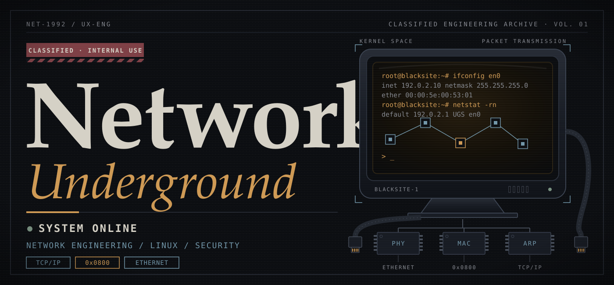
</p>

<p align="center">
  <a href="#overview"></a>
  <a href="#network"></a>
  <a href="#roadmap"></a>
  <a href="#lab"></a>
  <a href="#archive"></a>
</p>

<a id="overview"></a>

<p align="center">
  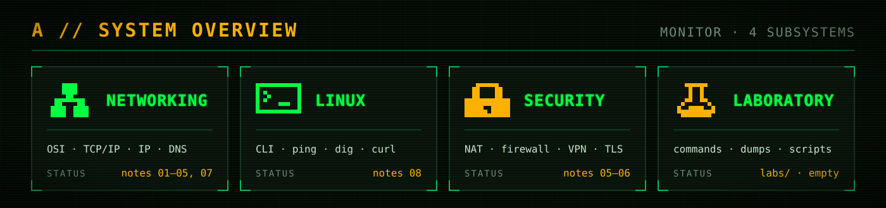
</p>

<a id="network"></a>

<p align="center">
  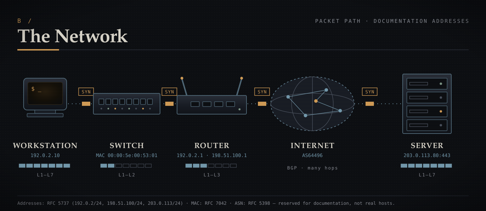<br>
  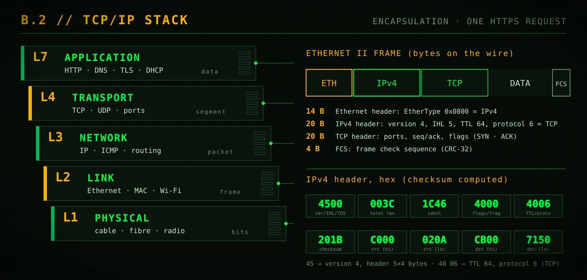
</p>

<a id="roadmap"></a>

<p align="center">
  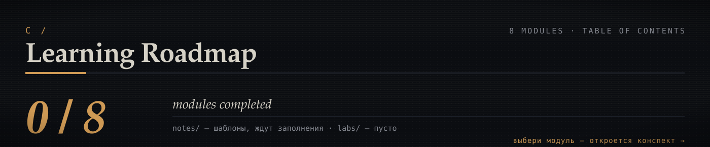<br>
  <a href="notes/01-basics.md">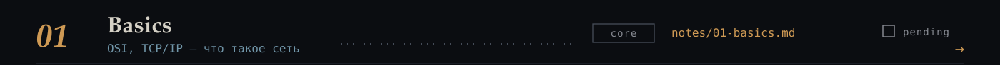</a><br>
  <a href="notes/02-physical-link.md">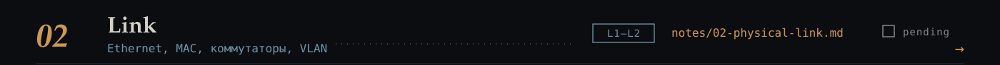</a><br>
  <a href="notes/03-ip.md">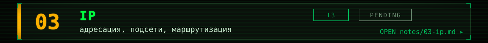</a><br>
  <a href="notes/04-transport.md">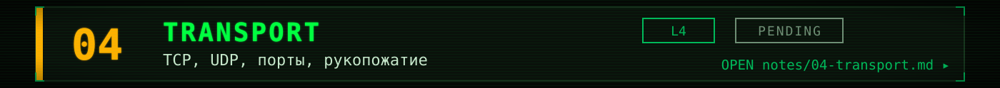</a><br>
  <a href="notes/05-app-protocols.md">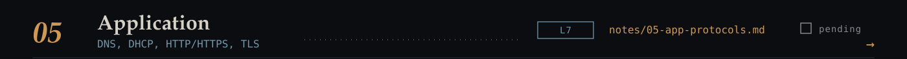</a><br>
  <a href="notes/06-nat-firewall.md">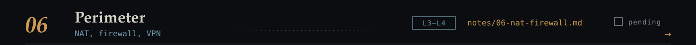</a><br>
  <a href="notes/07-wifi.md">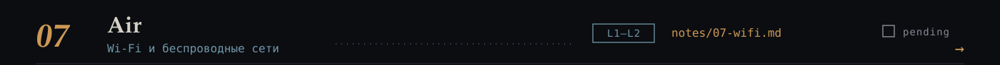</a><br>
  <a href="notes/08-tools.md">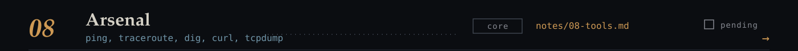</a>
</p>

<a id="lab"></a>

<p align="center">
  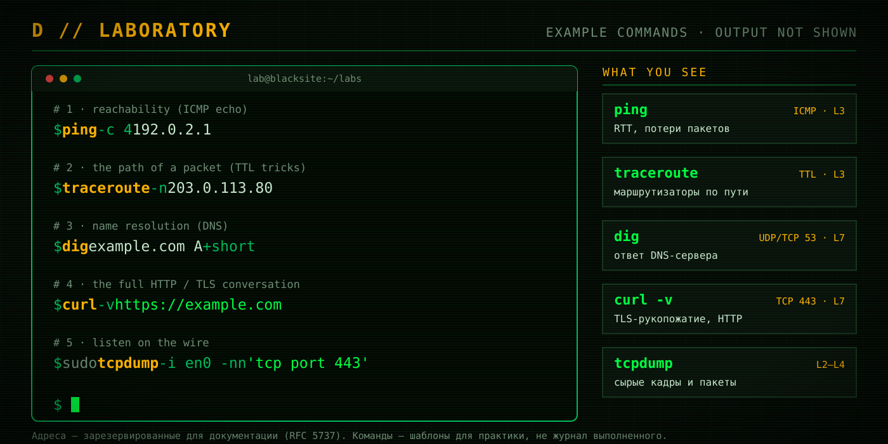
</p>

<details>
<summary><b>▸ copy-paste the lab commands</b></summary>

```console
ping -c 4 192.0.2.1
traceroute -n 203.0.113.80
dig example.com A +short
curl -v https://example.com
sudo tcpdump -i en0 -nn 'tcp port 443'
```

`192.0.2.1` и `203.0.113.80` — адреса из блоков для документации (RFC 5737): на них ничего не отвечает. Для реальной практики подставь свой роутер или `example.com`. Результаты и дампы складывай в [`labs/`](labs/).

</details>

<details>
<summary><b>▸ method: read → write → hack → break → repeat</b></summary>

1. **READ** — прочитал тему.
2. **WRITE** — записал главное своими словами в [`notes/`](notes/).
3. **HACK** — повторил руками в терминале → [`labs/`](labs/).
4. **BREAK** — сломал, посмотрел в `tcpdump` / Wireshark, понял почему.
5. **REPEAT** — непонятное → раздел «Вопросы» конспекта, вернуться позже.

Проверять всё только в **собственной сети или лабораторной среде**. Чужие сети без разрешения владельца не трогаем.

</details>

<details>
<summary><b>▸ primary sources: RFC</b></summary>

| RFC | Тема |
|---|---|
| [RFC 791](https://www.rfc-editor.org/rfc/rfc791) | IP |
| [RFC 792](https://www.rfc-editor.org/rfc/rfc792) | ICMP (ping) |
| [RFC 793](https://www.rfc-editor.org/rfc/rfc793) | TCP |
| [RFC 768](https://www.rfc-editor.org/rfc/rfc768) | UDP |
| [RFC 1034](https://www.rfc-editor.org/rfc/rfc1034) / [1035](https://www.rfc-editor.org/rfc/rfc1035) | DNS |
| [RFC 5737](https://www.rfc-editor.org/rfc/rfc5737) | адреса для документации |

</details>

<a id="archive"></a>

<p align="center">
  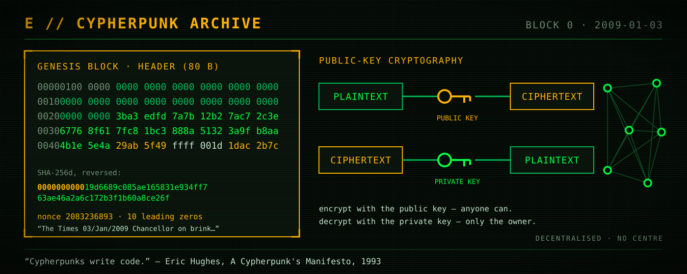
</p>

<p align="center">
  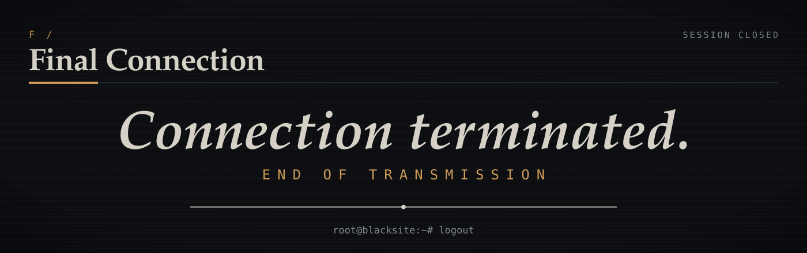<br>
  <a href="#top"></a>
</p>
