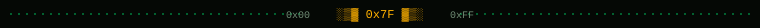

<div align="center">



**[ [01 WHOAMI](#01--whoami) ] [ [02 MODULES](#02--system-modules) ] [ [03 TOPOLOGY](#03--network-topology) ] [ [04 ARCHIVE](#04--project-archive) ] [ [05 LINUX & SEC](#05--cybersecurity--linux) ] [ [06 ACTIVITY](#06--github-activity) ] [ [07 CYPHERPUNK](#07--cypherpunk-corner) ] [ [08 CONNECT](#08--contact) ]**

</div>



## 01 / WHOAMI

```console
$ whoami
Doosi41

$ cat ~/.plan
Изучаю компьютерные сети с нуля: от кабеля до пакета.
Теория — своими словами (notes/), практика — руками в терминале (labs/).
Лог начат 2026-11-14. Здесь только то, что реально изучено или записано.

$ echo $STATUS
learning   # не эксперт, не сертифицирован, не продаю услуги
```


## 02 / SYSTEM MODULES

```console
$ ls /usr/local/skills/
```

Модули — это программа обучения. Статус честный: пока ни один не пройден.

| Статус | Модуль | Слой | Что внутри | Конспект |
|:-:|---|:-:|---|---|
| `[ .. ]` | **networking/basics** | — | OSI, TCP/IP, что такое сеть | [01-basics](notes/01-basics.md) |
| `[ .. ]` | **networking/link** | L1–L2 | Ethernet, MAC, коммутаторы, VLAN | [02-physical-link](notes/02-physical-link.md) |
| `[ .. ]` | **networking/ip** | L3 | адресация, подсети, маршрутизация | [03-ip](notes/03-ip.md) |
| `[ .. ]` | **networking/transport** | L4 | TCP, UDP, порты, рукопожатие | [04-transport](notes/04-transport.md) |
| `[ .. ]` | **networking/app** | L7 | DNS, DHCP, HTTP/HTTPS, TLS | [05-app-protocols](notes/05-app-protocols.md) |
| `[ .. ]` | **security/perimeter** | L3–L4 | NAT, firewall, VPN | [06-nat-firewall](notes/06-nat-firewall.md) |
| `[ .. ]` | **networking/air** | L1–L2 | Wi-Fi | [07-wifi](notes/07-wifi.md) |
| `[ .. ]` | **tools/cli** | — | ping, traceroute, dig, curl, tcpdump, Wireshark | [08-tools](notes/08-tools.md) |

```
legend:  [ .. ] planned    [ >> ] in progress    [ OK ] done & practiced in labs/
progress [░░░░░░░░░░░░░░░░░░░░]  0 / 8
```


## 03 / NETWORK TOPOLOGY



Путь, который я учусь прослеживать: `WORKSTATION → ROUTER → FIREWALL → SERVER`.
Схема декоративная — это не моя реальная инфраструктура.


## 04 / PROJECT ARCHIVE

```console
$ ls -la ~/projects/
drwxr-xr-x  network/    # этот репозиторий

$ cat ~/projects/network/INFO
name     : network
purpose  : конспекты и лабы по компьютерным сетям
stack    : Markdown, shell (labs/ пока пуст)
source   : https://github.com/Doosi41/network
status   : active, early stage (0/8 модулей)
```

```
network/
├── readme.md     ← ты здесь
├── assets/       ← SVG-графика этого лендинга
├── notes/        ← конспекты по темам
└── labs/         ← практика: команды, скрипты, дампы
```


## 05 / CYBERSECURITY & LINUX

Раздел — про то, что я учу, а не про то, что умею. Примеры ниже — учебные, не из реальных систем.

```console
$ man tcp
TCP(7)                       Learning Manual                       TCP(7)

NAME
       tcp — надёжная, упорядоченная доставка байтов поверх IP

THREE-WAY HANDSHAKE
       client                                   server
         │ ── SYN, seq=x ───────────────────────► │   «хочу соединиться»
         │ ◄─────────────── SYN+ACK, seq=y, ack=x+1 │   «слышу, готов»
         │ ── ACK, ack=y+1 ─────────────────────► │   «поехали»
```

```console
$ ls -l /etc/passwd
-rw-r--r--  1 root  wheel  ...  /etc/passwd
   │└┬┘└┬┘└┬┘
   │ │  │  └─ other : r--   читать могут все
   │ │  └──── group : r--
   │ └─────── owner : rw-   писать может только владелец
   └───────── тип   : -     обычный файл
```

```console
$ sudo tcpdump -i en0 -n port 53        # в планах: смотреть DNS своими глазами
```


## 06 / GITHUB ACTIVITY

```console
$ git log --oneline        # снимок на момент написания README
0814456 Redesign readme as retro terminal landing page
7c661a6 Add network learning notes structure and retro-style readme
25d605f Initial commit
```

Только реальные данные: без сторонних виджетов, которые могут сломаться или показать чужую статистику.


## 07 / CYPHERPUNK CORNER



Genesis-блок Bitcoin: 80 байт заголовка, двойной SHA-256 и ровно 10 нулей в начале хеша — вот и весь proof of work.
Хеш пересчитан и совпал с опубликованным. Никаких кошельков и адресов: это просто история и красивый hex.

> *«Cypherpunks write code.»* — Eric Hughes, A Cypherpunk's Manifesto, 1993


## 08 / CONTACT

```console
$ ./connect.sh
> INITIALIZING CONNECTION...
> RESOLVING ENDPOINT... github.com
> READY FOR INCOMING TRANSMISSION.
```

<div align="center">

**[ [ GITHUB · Doosi41 ](https://github.com/Doosi41) ]**

</div>

```console
root@localhost:~# logout
Connection to network closed.
[ session terminated · 0 packets lost · EOF ]
```

> ⚠ Всё описанное проверяется **только в собственной сети или в лабораторной среде**. Чужие сети без разрешения владельца не трогаем.
