<div align="center">



<br>


**[ [BOOT](#-boot) ]  [ [STACK](#-stack) ]  [ [ROADMAP](#-roadmap) ]  [ [METHOD](#-method) ]  [ [ARSENAL](#-arsenal) ]  [ [RULES](#-rules) ]**

</div>

<br>

## ▌BOOT

> *«The network is the computer.»* — Sun Microsystems, 1984

Никакой магии. Сеть — это **байты, провода и договорённости** (протоколы).
Этот репозиторий — мой лог изучения сетей с нуля: теория своими словами,
практика руками в терминале, пакеты под лупой `tcpdump`.

```console
$ git clone https://github.com/Doosi41/network.git
$ cd network
$ ls
assets/  labs/  notes/  readme.md
```

<br>

## ▌STACK

Что происходит между `Enter` и ответом сервера:

```
 YOU ─► curl https://example.com
  │
  ▼
┌────────────────────────────────────────────────────────────┐
│ L7  APPLICATION   HTTP · DNS · TLS · DHCP                  │ ◄─ говорим
├────────────────────────────────────────────────────────────┤
│ L4  TRANSPORT     TCP · UDP · ports                        │ ◄─ доставляем
├────────────────────────────────────────────────────────────┤
│ L3  NETWORK       IP · ICMP · routing                      │ ◄─ маршрутизируем
├────────────────────────────────────────────────────────────┤
│ L2  LINK          Ethernet · MAC · VLAN · Wi-Fi            │ ◄─ соседу по проводу
├────────────────────────────────────────────────────────────┤
│ L1  PHYSICAL      cable · fiber · radio · voltage          │ ◄─ электроны
└────────────────────────────────────────────────────────────┘
  │
  ▼
 ≋≋≋≋≋≋≋≋≋≋≋≋≋≋≋≋≋≋≋≋≋≋≋≋≋≋≋≋≋≋ wire ≋≋≋≋≋≋≋≋≋≋≋≋≋≋≋≋≋≋≋≋≋≋≋≋≋≋≋≋≋ ─► ???
```

<br>

## ▌ROADMAP

```
[░░░░░░░░░░░░░░░░░░░░]   0 %    0 / 8 modules       uptime: day 1
```

| | Модуль | Слой | Что внутри | Конспект |
|:-:|---|:-:|---|---|
| `[ ]` | **01 BASICS** | — | OSI, TCP/IP, что вообще такое сеть | [notes/01-basics.md](notes/01-basics.md) |
| `[ ]` | **02 LINK** | L1–L2 | Ethernet, MAC, коммутаторы, VLAN | [notes/02-physical-link.md](notes/02-physical-link.md) |
| `[ ]` | **03 IP** | L3 | Адресация, подсети, маршрутизация | [notes/03-ip.md](notes/03-ip.md) |
| `[ ]` | **04 TRANSPORT** | L4 | TCP, UDP, порты, рукопожатие | [notes/04-transport.md](notes/04-transport.md) |
| `[ ]` | **05 APP** | L7 | DNS, DHCP, HTTP/HTTPS, TLS | [notes/05-app-protocols.md](notes/05-app-protocols.md) |
| `[ ]` | **06 PERIMETER** | L3–L4 | NAT, firewall, VPN | [notes/06-nat-firewall.md](notes/06-nat-firewall.md) |
| `[ ]` | **07 AIR** | L1–L2 | Wi-Fi и беспроводные сети | [notes/07-wifi.md](notes/07-wifi.md) |
| `[ ]` | **08 ARSENAL** | — | ping, traceroute, dig, curl, tcpdump, Wireshark | [notes/08-tools.md](notes/08-tools.md) |

<br>

## ▌METHOD

```
  ┌──────┐   ┌───────┐   ┌──────┐   ┌───────┐   ┌────────┐
  │ READ │──►│ WRITE │──►│ HACK │──►│ BREAK │──►│ REPEAT │
  └──────┘   └───────┘   └──────┘   └───────┘   └────┬───┘
      ▲                                              │
      └──────────────────────────────────────────────┘
```

| Шаг | Действие | Куда |
|---|---|---|
| **READ** | прочитал тему | — |
| **WRITE** | записал главное своими словами | [`notes/`](notes/) |
| **HACK** | повторил руками в терминале | [`labs/`](labs/) |
| **BREAK** | сломал, посмотрел в `tcpdump`, понял почему | [`labs/`](labs/) |
| **REPEAT** | непонятное → раздел «Вопросы», вернуться позже | [`notes/`](notes/) |

<br>

## ▌ARSENAL

Первые пять команд, с которых всё начинается:

```console
$ ping -c 3 1.1.1.1               # жив ли хост (ICMP)
$ traceroute 1.1.1.1              # путь пакета по маршрутизаторам
$ dig example.com +short          # кто такой example.com (DNS)
$ curl -v https://example.com     # весь HTTP/TLS разговор
$ sudo tcpdump -i en0 -n port 53  # подслушать DNS-запросы
```

<details>
<summary><b>▸ Первоисточники: RFC</b></summary>

<br>

| RFC | О чём |
|---|---|
| [RFC 791](https://www.rfc-editor.org/rfc/rfc791) | IP |
| [RFC 792](https://www.rfc-editor.org/rfc/rfc792) | ICMP (ping) |
| [RFC 793](https://www.rfc-editor.org/rfc/rfc793) | TCP |
| [RFC 768](https://www.rfc-editor.org/rfc/rfc768) | UDP |
| [RFC 1034](https://www.rfc-editor.org/rfc/rfc1034) / [1035](https://www.rfc-editor.org/rfc/rfc1035) | DNS |

</details>

<details>
<summary><b>▸ Man-страницы</b></summary>

<br>

```console
$ man ping
$ man tcpdump
$ man dig
```

</details>

<details>
<summary><b>▸ Ресурсы (книги, курсы, видео)</b></summary>

<br>

_добавляй сюда по ходу обучения_

</details>

<br>

## ▌RULES

```
 1.  Не понял — разбери до байта.
 2.  Прочитал ≠ знаешь. Знаешь = повторил руками.
 3.  Пакеты не врут. Смотри в tcpdump / Wireshark.
 4.  Ломай только своё: своя сеть, свой лаб, свои железки.
 5.  RFC — первоисточник. Блоги — подсказки.
```

> ⚠ Всё, что здесь описано, проверяется **только в собственной сети или в лабораторной среде**.
> Чужие сети без разрешения владельца не трогаем.

<br>

<div align="center">

```
╔════════════════════════════════════════╗
║  connection to network closed.   EOF   ║
╚════════════════════════════════════════╝
```

`$ _`

</div>
